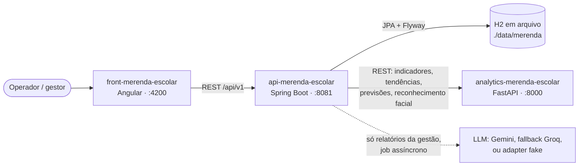

# Frontend — Controle de Merenda Escolar

Interface web do protótipo de controle da merenda escolar: operação da fila (QR Code e reconhecimento facial), cadastro de cardápios, alunos e turmas, fechamento do turno e dashboard gerencial. Feita em Angular 20 com Standalone Components, signals e Tailwind CSS 4.

Este repositório é só a camada de apresentação. Regras de negócio, persistência e auditoria ficam na API (`api-merenda-escolar`); o Angular cuida de captura, exibição e integração HTTP.

## Arquitetura

O protótipo é formado por três repositórios que rodam juntos:

| Repositório | Papel | Stack | Porta local |
|---|---|---|---|
| `front-merenda-escolar` | Telas: fila (QR Code e facial), cardápio, fechamento de turno, cadastro de alunos e turmas, dashboard | Angular 20, Tailwind 4, Chart.js, html5-qrcode | 4200 |
| `api-merenda-escolar` | Regras de negócio, persistência, auditoria da fila, consolidação, jobs de relatório com LLM | Spring Boot 3.5, Java 25, Spring AI, Flyway, H2 em arquivo | 8081 |
| `analytics-merenda-escolar` | Cálculos determinísticos (indicadores, tendências, previsão) e reconhecimento facial (DeepFace) | FastAPI, Python 3.12+ | 8000 |



Princípios que orientam o código (o porquê de cada um está em `api-merenda-escolar/DECISOES-TECNICAS.md`):

- **A fila é síncrona e nunca chama o LLM.** Autoriza ou bloqueia o consumo numa transação; indisponibilidade da IA não afeta a fila.
- **A gestão é assíncrona.** O relatório com IA vira um job persistido (`relatorio_ia`); o front consulta o status.
- **Número é calculado, não gerado.** Indicadores e a conclusão numérica saem de código determinístico; o LLM só redige a partir deles e recebe apenas dados agregados.
- **O serviço Python não é dono de tabela.** Tudo o que ele precisa chega no pedido; ele não guarda foto, embedding nem dado de domínio.
- **Item é identificado por id, nunca por nome.**

Ordem para subir localmente: analytics (8000) → API (8081) → front (4200).

### O front nessa arquitetura

- O front conversa **só com a API**. A URL base fica em `src/environments/environment.ts`:

  ```ts
  export const environment = {
    apiBaseUrl: 'http://localhost:8081/api/v1',
  } as const;
  ```

  Todos os serviços de `data-access` montam as URLs a partir de `environment.apiBaseUrl`. Há um único arquivo de ambiente e o `angular.json` não tem `fileReplacements`, então o build de produção usa o mesmo valor.
- O front **nunca chama o analytics** (porta 8000). Indicadores, tendências e o reconhecimento facial chegam já processados pela API.
- Não há proxy de desenvolvimento: o navegador chama `http://localhost:8081` direto. A API libera CORS apenas para a origem `http://localhost:4200` (`WebConfig` em `api-merenda-escolar`), por isso abra o front por `localhost`, não por `127.0.0.1` nem pelo IP da máquina.
- Se o endereço da API mudar, ajuste também as mensagens de falha de comunicação, que citam `http://localhost:8081` fixo em `fila-page.component.ts`, `cardapio-page.component.ts` e `cadastro/application/mensagem-erro.ts`.

## Como começar

### Pré-requisitos

| Ferramenta | Versão | Observação |
|---|---|---|
| Node.js | `^20.19.0`, `^22.12.0` ou `>=24.0.0` | Faixa exigida pelo campo `engines` do Angular 20.3. |
| pnpm | não fixada | É o gerenciador do projeto: o `angular.json` define `cli.packageManager: pnpm` e o lock é o `pnpm-lock.yaml`. O `package.json` não tem o campo `packageManager`; o `node_modules` atual foi instalado com pnpm 11.24.0. |
| Google Chrome ou Chromium | qualquer recente | Necessário só para os testes (Karma). |
| API e analytics rodando | — | Sem a API em `:8081` as telas abrem, mas todas as consultas falham. |

O `pnpm-workspace.yaml` autoriza scripts de instalação apenas para `esbuild`, `lmdb`, `@parcel/watcher` e `msgpackr-extract`.

### Instalação e execução

```bash
pnpm install
pnpm start
```

`pnpm start` roda `ng serve` com a configuração `development` (padrão do `serve` no `angular.json`) e publica a aplicação em `http://localhost:4200`, com recarga automática ao salvar. Suba antes o analytics e a API, na ordem indicada na seção Arquitetura.

### Scripts do `package.json`

| Comando | Executa | Para quê |
|---|---|---|
| `pnpm start` | `ng serve` | Servidor de desenvolvimento em `:4200`, configuração `development` (sem otimização, com source maps). |
| `pnpm build` | `ng build` | Build com a configuração padrão `production` (otimizado, com hash nos nomes) em `dist/front-merenda-escolar/browser/`. Avisa quando o bundle inicial passa de 500 kB e falha acima de 1 MB; para o CSS de cada componente, aviso em 4 kB e falha em 8 kB. |
| `pnpm watch` | `ng build --watch --configuration development` | Rebuild contínuo em modo desenvolvimento, sem servidor. |
| `pnpm test` | `ng test` | Testes unitários com Karma e Jasmine (ver abaixo). |
| `pnpm ng <comando>` | `ng` | Acesso direto ao Angular CLI, por exemplo `pnpm ng generate component ...`. |

Não há script de lint nem formatador instalado. O `package.json` traz apenas a configuração do Prettier (largura 100, aspas simples, parser `angular` para HTML), sem o pacote nas dependências.

### Testes

- Runner: Karma com Jasmine, pelo builder `@angular/build:karma`. Não existe `karma.conf.js`, então vale a configuração padrão do Angular: navegador `Chrome` e modo watch (reexecuta ao salvar).
- É preciso ter Chrome ou Chromium instalado. O `karma-chrome-launcher` procura o binário no sistema; se não encontrar, aponte a variável `CHROME_BIN` para ele.
- Execução única, sem abrir janela:

  ```bash
  pnpm test --watch=false --browsers=ChromeHeadless
  ```

- Há 10 arquivos `*.spec.ts`: `app.spec.ts`; `qr-code-parser`, `qr-scanner` e `resultado-validacao` (fila); `aluno-page` e `transferencia-form` (cadastro); `cardapio-form` (cardápio); `dashboard-page` e `indicadores-logisticos` (dashboard); `fechamento-page` (fechamento). Ainda sem spec: `fila-page`, `camera-foto`, `turma-page` e `cardapio-page`.

## Mapa do código

```text
src/
├── index.html                     Página base (lang pt-BR; fontes Plus Jakarta Sans e Material Symbols)
├── main.ts                        bootstrapApplication(App, appConfig)
├── styles.css                     Tailwind 4 (@import "tailwindcss") e tema @theme: cores brand-* e surface-*
├── environments/
│   └── environment.ts             apiBaseUrl da API
└── app/
    ├── app.ts / app.html          Casca: cabeçalho com o menu, <router-outlet> e rodapé
    ├── app.config.ts              provideRouter, provideHttpClient(withFetch()), zone com eventCoalescing
    ├── app.routes.ts              Rotas, todas com carregamento sob demanda (loadComponent)
    ├── shared/
    │   └── components/
    │       └── camera-foto/       Captura de foto pela webcam (fila facial e cadastro de rosto)
    └── features/
        ├── cadastro/              Alunos e turmas
        ├── cardapio/              Cardápios por data e turno
        ├── dashboard/             Indicadores e análise IA
        ├── fechamento/            Fechamento do turno (sobras)
        └── fila/                  Operação da fila
```

O Tailwind 4 não usa `tailwind.config.*`: entra pelo plugin `@tailwindcss/postcss` declarado em `.postcssrc.json`, e o tema fica no bloco `@theme` de `src/styles.css`. Não existe pasta `core/` hoje; a configuração global está em `app.config.ts`.

### Features e telas

| Feature | Rota | Tela |
|---|---|---|
| `fila` | `/fila` | Operação na fila: identifica o aluno por QR Code ou reconhecimento facial e mostra AUTORIZADO ou BLOQUEADO, com sinal verde ou vermelho. |
| `cardapio` | `/cardapio` | Cadastro, edição e exclusão de cardápios por data e turno, com itens escolhidos do catálogo de receitas. |
| `cadastro` | `/alunos` | Alunos: listagem, criação, edição, detalhe com turma vigente e histórico de vínculos, transferência de turma e cadastro de rosto. |
| `cadastro` | `/turmas` | Turmas: listagem, criação, edição e exclusão. |
| `fechamento` | `/fechamento` | Fechamento do turno: quem serviu registra o preparado e as sobras de cada item; ao fechar, um relatório IA é solicitado. |
| `dashboard` | `/dashboard` | Gestão: aba Indicadores (números determinísticos) e aba Análise IA (histórico e geração de relatório). |

### Rotas

Definidas em `src/app/app.routes.ts`. Todas carregam o componente sob demanda. O menu do cabeçalho (`app.ts`) segue a ordem Fila, Cardápios, Alunos, Turmas, Fechamento, Dashboard.

| Rota | Componente | Chamadas à API (prefixo `/api/v1`) |
|---|---|---|
| `/fila` | `FilaPageComponent` | `POST /fila/validacoes` |
| `/cardapio` | `CardapioPageComponent` | `GET` e `POST /cardapios`; `PUT` e `DELETE /cardapios/{id}`; `GET /receitas` |
| `/alunos` | `AlunoPageComponent` | `GET` e `POST /alunos`; `GET` e `PUT /alunos/{id}`; `POST /alunos/{id}/transferencias`; `POST /alunos/{id}/rosto`; `GET /turmas` |
| `/turmas` | `TurmaPageComponent` | `GET` e `POST /turmas`; `PUT` e `DELETE /turmas/{id}` |
| `/fechamento` | `FechamentoPageComponent` (export default) | `GET /cardapios`; `GET /gestao/consolidacoes`; `GET /medicoes-sobra?data&turno`; `POST /medicoes-sobra/fechamento`; `POST /relatorios-ia` |
| `/dashboard` | `DashboardPageComponent` | `GET /gestao/consolidacoes`; `GET /gestao/indicadores`; `GET /gestao/cardapios-analise`; `GET /relatorios-ia?data&turno`; `POST /relatorios-ia`; `GET /relatorios-ia/{id}` |
| `''` e qualquer outra | — | Redirecionam para `/fila`. |

## Fila: QR Code e reconhecimento facial

A tela `/fila` tem um seletor **QR Code / Reconhecimento facial**. Trocar o modo limpa o resultado e o erro exibidos. Os dois modos terminam na mesma chamada, `POST /api/v1/fila/validacoes`, com `alunoCodigo` e `metodoIdentificacao` (`QR_CODE` ou `FACIAL`); no modo facial vai também `fotoBase64`. Autorização, bloqueio de consumo repetido e auditoria são responsabilidades exclusivas da API.

A resposta traz `resultado` (`AUTORIZADO` ou `BLOQUEADO`), `sinal` (`VERDE` ou `VERMELHO`), nome do aluno, turno, cardápio e `motivo`. A tela também mostra quantas leituras foram autorizadas desde que foi aberta; é a contagem da sessão, não o total do dia.

### Modo QR Code

- O componente `fila/components/qr-scanner` usa `html5-qrcode` com a câmera traseira (`facingMode: 'environment'`) e só liga a câmera depois do clique.
- Também lê o QR Code de uma imagem escolhida no computador.
- Ignora o mesmo código lido de novo em menos de 3 segundos e pausa a leitura enquanto uma validação está em andamento.
- O campo **Código de teste** permite digitar o código sem câmera; ele passa pelo mesmo parser e é enviado como `QR_CODE`.

#### Formatos aceitos no QR Code

A interpretação fica em `fila/application/qr-code-parser.ts`. O formato mais simples para demonstração é texto puro (espaços nas pontas são removidos):

```text
ALU-001
```

Também é aceito um JSON versionado, mais adequado para integração futura:

```json
{
  "tipo": "ALUNO",
  "alunoCodigo": "ALU-001",
  "versao": 1
}
```

Para compatibilidade com testes iniciais, o JSON também pode trazer o campo `codigo` no lugar de `alunoCodigo`. O parser lê apenas `alunoCodigo` (ou `codigo`); `tipo` e `versao` não são conferidos. JSON sem código válido é recusado com "QR Code inválido ou fora do padrão esperado.", sem chamar a API.

#### Códigos de demonstração

A API cria três alunos ao subir com a tabela de alunos vazia (`DadosIniciaisConfig`, fora do perfil `test`):

| Código | Nome |
|---|---|
| `ALU-001` | Ana Souza |
| `ALU-002` | Bruno Lima |
| `ALU-003` | Carla Santos |

### Modo reconhecimento facial (verificação 1:1)

Hoje o modo facial **não descobre sozinho quem é o aluno**. O operador informa o código do aluno (o campo já vem com `ALU-001`), inicia a câmera e captura a foto. Cada captura dispara uma validação com o código e a foto, e a API confere 1:1 se o rosto bate com o cadastrado **daquele** aluno, sem procurar entre os demais. O cálculo facial é feito pelo analytics (DeepFace), chamado pela API.

Sem código informado, a tela recusa localmente com "Informe o código do aluno antes de capturar a foto.". Um aluno precisa ter o rosto cadastrado em `/alunos` antes de ser validado por este modo.

#### Motivos de bloqueio

A API devolve um código em `motivo`; `fila/components/resultado-validacao/resultado-validacao.component.ts` traduz os conhecidos. Código desconhecido aparece como veio.

| Código | Texto exibido |
|---|---|
| `CONSUMO_RECENTE_BLOQUEADO` | Consumo recente: este aluno já foi validado há pouco tempo. |
| `ALUNO_NAO_ENCONTRADO_OU_INATIVO` | Aluno não encontrado ou inativo. |
| `CARDAPIO_NAO_CONFIGURADO` | Cardápio não configurado. |
| `FOTO_NAO_INFORMADA` | Nenhuma foto foi capturada para a validação facial. |
| `ALUNO_SEM_ROSTO_CADASTRADO` | Este aluno ainda não tem rosto cadastrado. |
| `ROSTO_NAO_DETECTADO` | Não foi possível detectar um rosto na foto capturada. |
| `ROSTO_NAO_CONFERE` | O rosto capturado não confere com o cadastrado para este aluno. |

A janela de bloqueio por repetição é configurada na API; o front não fixa esse número.

### Componente de câmera compartilhado

`shared/components/camera-foto` é usado na fila (modo facial) e no cadastro de rosto do aluno.

- A câmera só é acionada pelo botão **Iniciar câmera**, nunca ao abrir a tela, para o pedido de permissão do navegador não aparecer antes de a pessoa entender o que está acontecendo.
- Usa `navigator.mediaDevices.getUserMedia` com a câmera frontal (`facingMode: 'user'`) e sem áudio.
- **Capturar foto** desenha o quadro atual num canvas e emite uma data URL JPEG em base64 (`data:image/jpeg;base64,...`, qualidade 0,9) pelo output `fotoCapturada`. O componente não envia nada; quem o usa decide o que fazer com a foto.
- A câmera é desligada em **Parar câmera** e ao sair da tela.
- O navegador só libera a câmera em contexto seguro; `http://localhost` atende.

### Privacidade da foto

A foto nunca é gravada no front: fica em memória apenas para a miniatura da última captura e segue direto para a API. A API guarda somente o embedding (vetor) gerado pelo analytics, nunca a imagem, e o analytics não guarda nada.

## Cadastro de alunos e turmas

A feature `cadastro` expõe duas rotas: `/alunos` e `/turmas`.

- `/turmas`: listagem, criação, edição e exclusão (`GET|POST|PUT|DELETE /api/v1/turmas`).
- `/alunos`: listagem, criação e edição (`GET|POST|PUT /api/v1/alunos`). O detalhe (`GET /api/v1/alunos/{id}`) mostra a turma vigente e o histórico de vínculos. Na criação, turma inicial e data de início são opcionais, mas precisam vir juntas.
- A transferência de turma é ação própria (`POST /api/v1/alunos/{id}/transferencias`, com `turmaId` e `dataMudanca`), separada da edição do aluno. A API rejeita data anterior ao início do vínculo vigente e sobreposição; a rejeição aparece na tela.
- **Cadastrar rosto:** no detalhe do aluno aparece "Rosto cadastrado: sim/não" e o botão **Cadastrar rosto** (ou **Recadastrar rosto**). A foto capturada vai para `POST /api/v1/alunos/{id}/rosto` com `{ fotoBase64 }`; a API devolve o aluno atualizado com `temRostoCadastrado`.
- Erros de regra de negócio (409 de turma em uso, 400 de validação, transferência rejeitada) aparecem com o `detail` devolvido pela API (`cadastro/application/mensagem-erro.ts`).

## Cardápios

A rota `/cardapio` cadastra os cardápios servidos por data e turno (`MANHA`, `TARDE`, `NOITE`, `INTEGRAL`), com nome da refeição, descrição, itens e quantidade planejada. A fila, o fechamento e o dashboard usam esses dados.

Os itens são escolhidos do catálogo `GET /api/v1/receitas` e identificados por `receitaId`, não digitados por nome: a API recusa nome fora do catálogo, e nome não identifica nada de forma estável.

## Fechamento do turno

A rota `/fechamento` é onde quem serviu registra o que sobrou, por data e turno.

- A tela localiza o cardápio da data e do turno. Sem cardápio, avisa; se algum item não estiver vinculado ao catálogo de receitas, pede para regravar o cardápio antes de medir.
- Para cada item pede três números: porções preparadas, sobra na panela (não distribuída) e resto no prato. O servido não é informado: é derivado (preparado menos sobra na panela).
- O preparado começa sugerido com a contagem de autorizações da fila no turno (`GET /gestao/consolidacoes`), e as perdas começam zeradas. A contagem não vira o servido por item, porque o QR registra uma refeição e não diz quais itens o aluno pegou.
- Se já houver medições para a data e o turno (`GET /medicoes-sobra`), os valores são carregados para edição, com aviso de que a alteração pode afetar indicadores e relatórios já gerados.
- Validações na tela, repetidas pela API: a sobra na panela não pode passar do preparado, e o resto no prato não pode passar do servido.
- Ao fechar, a tela envia `POST /medicoes-sobra/fechamento` e, em seguida, `POST /relatorios-ia` para a data e o turno.

## Dashboard gerencial

A rota `/dashboard` reúne a visão de gestão em duas abas com os mesmos filtros de **data** (padrão: hoje) e **turno** (padrão: `NOITE`), mais um filtro de **turma** preenchido com as turmas que tiveram atendimento no dia.

- **Indicadores:** consulta a consolidação (`GET /api/v1/gestao/consolidacoes`) e os cálculos determinísticos do Python, via API (`GET /api/v1/gestao/indicadores`), incluindo meta, aceitação e atendimentos. Atualizar ou navegar pelos filtros não gera relatório nem chama o LLM.
- **Análise IA:** carrega o histórico e permite gerar uma nova análise apenas pelo botão **Gerar análise IA**. Abrir um relatório salvo consulta o banco. Gráficos, metas e tabelas de indicadores são exibidos exclusivamente na aba Indicadores.

Alternar entre abas preserva o relatório selecionado e seu acompanhamento. Trocar data ou turno limpa a seleção (inclusive a turma) e cancela as consultas anteriores, para não misturar dados de turnos; isso não cancela um job já criado no backend. Relatórios antigos podem ser abertos mesmo sem cardápio ativo no filtro.

### Aba Indicadores

- Meta interna de execução (padrão 80%, configurada na API em `meta-execucao-percentual`), alunos únicos e repetições do dia e turno.
- Gráfico de barras com Chart.js da aceitação dos itens, calculada a partir dos fechamentos — (porções servidas − resto no prato) / porções servidas — nos últimos 30 dias (Mês) ou 7 dias (Semana) até a data de referência. Uma tabela acessível repete os valores: item, aceitação, consumidas estimadas sobre servidas, resto e número de fechamentos.
- Autorizações por turma (alunos únicos, autorizações e repetições). A turma exibida é a vigente do aluno na data do consumo; aluno sem enturmação aparece em "Sem turma". Adesão e rejeição não são inferidas sem dados de presença.
- O filtro de turma recorta a tabela por turma e as métricas da fila, e é enviado como `turmaId` ao gerar um relatório IA.
- Estados explícitos de dados insuficientes: amostragem insuficiente no período e ingredientes sem dados suficientes.

`IndicadoresLogisticosComponent` recebe os dados por input e não depende do roteamento. Chart.js entra apenas no chunk da rota do dashboard. O gráfico não usa números produzidos pelo LLM.

### Escopo visual dos indicadores

O dashboard separa explicitamente as responsabilidades:

- **Resumo operacional do dia:** cardápio, refeições planejadas, autorizações registradas, diferença do planejamento, bloqueios e execução registrada do dia e turno.
- **Aceitação alimentar — histórico de fechamentos:** aceitação dos itens em visão semanal ou mensal, desperdício medido e análise histórica de ingredientes.
- **Autorizações por turma:** detalhamento dos registros da fila no dia; não comprova que a refeição foi consumida.

### Aba Análise IA

- Histórico dos últimos 20 relatórios da data e turno (`GET /api/v1/relatorios-ia?data&turno`), listados com criação, status e provedor. Abrir um relatório exibe a análise persistida, sem nova chamada ao LLM; o snapshot permanece salvo no backend para rastreabilidade.
- A pessoa escolhe primeiro um cardápio servido (`GET /api/v1/gestao/cardapios-analise`). Os itens e as datas de fechamento exibidos pertencem ao cardápio selecionado, e não à amostra geral do período.
- A análise usa somente os dias em que todos os itens do cardápio foram fechados. **Gerar análise IA** só fica disponível com pelo menos 20 desses dias e ao menos um item escolhido, cada um com pelo menos 3 dias medidos.
- Com uma turma selecionada, o relatório narra autorizações, alunos únicos e repetições só dessa turma; aceitação, execução do planejamento e ingredientes continuam do turno inteiro, porque o resto no prato não é medido por turma.
- Ao gerar, o front cria o job (`POST /api/v1/relatorios-ia`) e consulta `GET /api/v1/relatorios-ia/{id}` a cada 1,5 segundo, até 40 vezes, enquanto o relatório estiver em processamento. Passado esse limite, orienta reabrir o relatório pelo histórico.

## Organização por features

O código é agrupado por capacidade de negócio, e não apenas por tipo técnico:

```text
src/app/
├── shared/
│   └── components/camera-foto/
└── features/
    ├── cadastro/
    │   ├── application/
    │   ├── components/
    │   ├── data-access/
    │   ├── models/
    │   └── pages/
    ├── cardapio/
    │   ├── components/
    │   ├── data-access/
    │   ├── models/
    │   └── pages/
    ├── dashboard/
    │   ├── components/
    │   ├── data-access/
    │   ├── models/
    │   └── pages/
    ├── fechamento/
    │   ├── data-access/
    │   ├── models/
    │   └── pages/
    └── fila/
        ├── application/
        ├── components/
        ├── data-access/
        ├── models/
        └── pages/
```

Essa decisão mantém cada área funcional autocontida. A fila, por exemplo, concentra sua página, o scanner, a interpretação do QR, os contratos HTTP, o serviço de API e os testes. Se a funcionalidade for incorporada ao sistema legado, suas dependências ficam explícitas e localizadas.

### Responsabilidade de cada pasta

- `pages`: componentes associados diretamente a rotas.
- `components`: componentes internos e especializados da feature.
- `application`: funções puras da feature, sem HTTP nem template (por exemplo, `qr-code-parser.ts` e `mensagem-erro.ts`).
- `data-access`: acesso HTTP e estado remoto daquela feature.
- `models`: contratos e tipos usados pela feature.
- `shared`: componentes visuais ou utilitários verdadeiramente genéricos.
- `core`: reservado para configuração e infraestrutura usadas por toda a aplicação. A pasta ainda não existe; hoje isso está em `app.config.ts`.

### Regras de dependência

- Uma feature não importa arquivos internos de outra feature.
- Código compartilhado por mais de uma feature pode ser promovido para `shared` ou `core`.
- `shared` não conhece features.
- `core` não contém regra de apresentação específica de uma feature.
- Regras de negócio de consumo permanecem no backend; o Angular cuida de captura, apresentação e integração HTTP.

Exceção existente hoje: `fechamento-page.component.ts` importa `CardapioApiService` e o tipo `Turno` de `cardapio`, e `DashboardApiService` de `dashboard`. É candidato a ser promovido para `shared` ou `core` quando a regra for aplicada.

## Bibliotecas principais

Versões conforme o `package.json`.

| Biblioteca | Versão | Uso |
|---|---|---|
| Angular (`@angular/*`) | `^20.3.0` | Framework: Standalone Components, signals, router e `HttpClient` com `fetch`. |
| Tailwind CSS e `@tailwindcss/postcss` | `^4.1.14` | Composição visual. |
| `chart.js` | `^4.5.1` | Gráfico de aceitação dos itens no dashboard. |
| `html5-qrcode` | `^2.3.8` | Leitura do QR Code pela câmera ou por imagem. |
| `rxjs` | `~7.8.0` | Requisições, cancelamento de consultas e acompanhamento do relatório IA. |
| `zone.js` | `~0.15.0` | Detecção de mudanças do Angular. |
| TypeScript | `~5.9.2` | Linguagem. |
| Karma, Jasmine e `karma-chrome-launcher` | `~6.4.0`, `~5.9.0`, `~3.2.0` | Testes unitários. |

O `face-api.js` foi removido (estava declarado e nunca foi usado). O reconhecimento facial não roda no navegador: o front só captura a foto e a envia à API, que usa o analytics (DeepFace).

## Pendências e próximos passos

- Adicionar filtro de turma para presença e adesão quando houver uma regra definida; hoje o filtro de turma do dashboard recorta apenas os registros da fila.
- Exibir, quando aplicável, um aviso claro de que dados sintéticos não representam uma operação real.
- Definir como a interface deve sinalizar que um relatório antigo pode ficar desatualizado após a edição de um fechamento.
- Revisar textos e rótulos do dashboard após a entrada de dados reais e feedback dos usuários.
- Avaliar filtros de período também na análise IA, mantendo a seleção do cardápio como escopo principal.
- Identificação facial 1:N (sem digitar código) e rostos de demonstração, em desenho.
